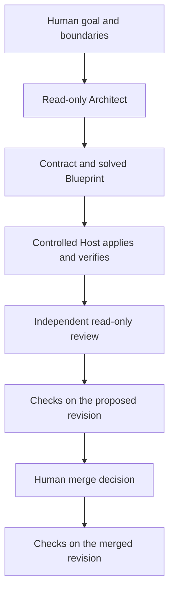
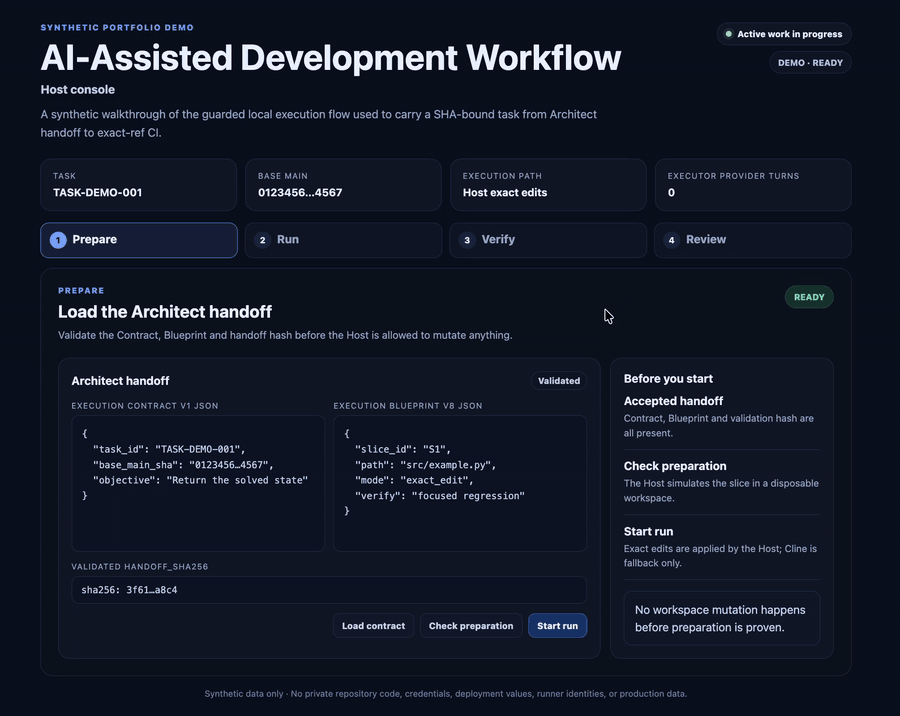

# AI-Assisted Development Workflow

[](https://github.com/wintersyntax/ai-assisted-development-workflow/actions/workflows/ci.yml)


**Using AI to build software while keeping scope, verification and final decisions under human control.**

## The problem and idea

An AI coding session can lose context, broaden a task or claim success without enough evidence. Tying project knowledge to one chat or model also makes work harder to resume. This experimental workflow keeps decisions in version-controlled files and separates planning, execution, verification and approval.

## How it works

A read-only Architect examines an exact code revision and prepares a bounded Contract + Blueprint, including exact edits where possible. A controlled Host applies those edits and runs checks. Cline is a restricted fallback for changes that need an executor. An independent read-only Reviewer inspects the result; integration follows explicit human approval and checks on the proposed and merged revisions.



Repository-owned prompts, ledgers and handoffs preserve context across sessions. OpenRouter supplies replaceable model access; it does not own project memory or completion authority. Fully specified exact-edit slices can run without an executor model call.

## Try the synthetic demo



*Prepare → Run → Verify → Review, using fictional portfolio content.*

```bash
python3 scripts/serve_demo.py
# Open http://127.0.0.1:8767
```

The demo illustrates operator stages and boundaries; it does not execute the private Host. The repository also includes example handoffs, a JSON schema and validation tooling.

## Explore the implementation

- [Implementation guide](docs/IMPLEMENTATION_GUIDE.md) — worked example, detailed diagrams, contracts and checkpoints.
- [Architecture](docs/ARCHITECTURE.md) and [workflow](docs/WORKFLOW.md) — responsibilities and execution paths.
- [Case study](docs/CASE_STUDY.md) — lessons from real development work.
- [Model and cost strategy](docs/MODEL_AND_COST_STRATEGY.md) — replaceable models and bounded execution.

## Current scope

Actively developed and used experimentally on real projects. This public repository presents documentation, contracts and a synthetic browser demo; it does not distribute the private Host runtime. Stage handoffs still require human coordination. It is not a finished framework or a claim that the workflow's semantic judgments are automatically correct.

MIT — see [LICENSE](LICENSE).
